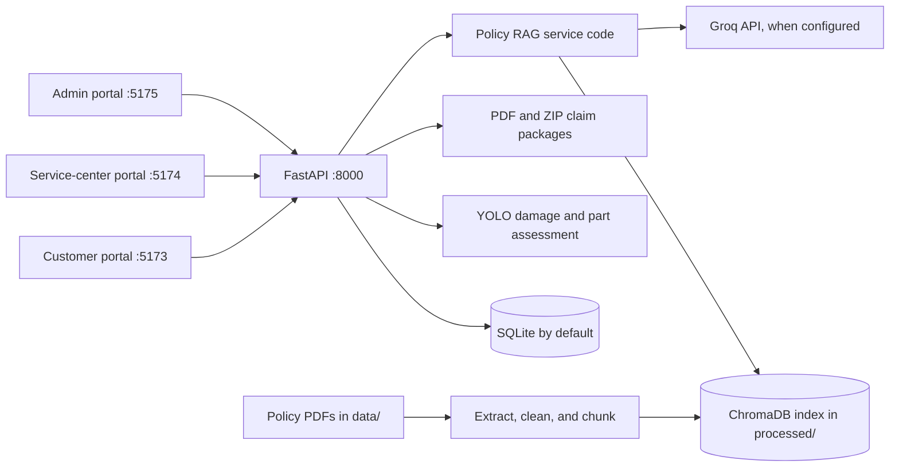

# AutoInsight — Vehicle Damage Insurance Assistance

**A claim-management platform that connects customers, service centers, computer-vision damage assessment, and insurance-policy search.**

## Table of Contents

- [Overview](#overview)
- [Features](#features)
- [Tech Stack](#tech-stack)
- [Architecture](#architecture)
- [Project Structure](#project-structure)
- [Getting Started](#getting-started)
- [Usage](#usage)
- [API Reference](#api-reference)
- [Testing](#testing)
- [Deployment](#deployment)
- [Roadmap](#roadmap)
- [Contributing](#contributing)
- [Troubleshooting and FAQ](#troubleshooting-and-faq)
- [License](#license)
- [Contact and Acknowledgements](#contact-and-acknowledgements)

## Overview

AutoInsight supports the vehicle-insurance claim workflow in one application. Customers register vehicles, submit claims and evidence, and track progress. Service-center staff review assigned claims, inspect AI assessment results, enter technician findings and repair estimates, and generate claim-package files. Platform administrators manage service-center organizations and staff invitations.

The project addresses a fragmented intake and review process by keeping customer-submitted claim information, service-center review, damage assessment, and policy-document search in a shared backend. It is intended for local development and evaluation by contributors, students, and teams prototyping vehicle-insurance workflows. AI outputs and indicative prices are decision-support information; they do not make coverage or settlement decisions.

## Features

- Separate customer, service-center, and platform-admin portals served from distinct local ports.
- Customer vehicle registration, claim submission, supporting-document upload, and claim-status tracking.
- Service-center claim queues, technician review, repair estimates, and PDF/ZIP claim-package generation.
- Platform-admin management of service-center locations, invitations, staff assignment, and claim routing by vehicle make and service coverage.
- YOLO-based vehicle-damage and vehicle-part detection, with fusion and severity logic in the assessment pipeline.
- Policy-document retrieval using ChromaDB and sentence-transformer embeddings, with optional Groq-generated answers and source metadata.
- Local model-evaluation evidence and SVG visualizations in [`MODEL_EVALUATION.md`](MODEL_EVALUATION.md) and [`evaluation/`](evaluation/).

## Tech Stack

| Area | Technologies |
| --- | --- |
| Frontend | React 19, TypeScript, Vite, Axios, Lucide React |
| Backend API | Python, FastAPI, Uvicorn, Pydantic Settings |
| Persistence | SQLAlchemy; SQLite by default; Alembic is included as a dependency |
| Computer vision | PyTorch, Ultralytics YOLO, OpenCV, NumPy, Pillow |
| Policy RAG | PyMuPDF, sentence-transformers (`all-MiniLM-L6-v2` by default), ChromaDB, Groq API |
| Claim artifacts | ReportLab; ZIP support uses Python standard-library facilities |
| Backend checks | pytest, pytest-asyncio |
| Frontend checks | Oxlint, TypeScript compiler, Vite build |

## Architecture

The application is a modular monolith: one FastAPI backend exposes versioned API routes, while one React/Vite codebase selects a role-specific portal using its port or `VITE_PORTAL_MODE`. SQLAlchemy stores users, vehicles, claims, and related records. Local uploads, generated packages, model weights, policy PDFs, and the ChromaDB index are filesystem artifacts rather than checked-in source.



Policy ingestion runs as local scripts: PDFs are extracted, cleaned, chunked, and embedded into a persistent ChromaDB collection. At query time, the RAG pipeline retrieves policy passages, then either asks Groq to draft a grounded response or returns retrieved text if the LLM is unavailable. Model weights and policy source documents are not distributed in this repository.

## Project Structure

```text
.
├── backend/                    # FastAPI application, database models, AI services, scripts, and tests
│   ├── app/                     # API, configuration, persistence, RAG integration, and business services
│   ├── rag_pipeline/scripts/    # Policy ingestion, vector search, chat, and evaluation scripts
│   ├── scripts/                 # Administrative bootstrap utilities
│   └── tests/                   # Backend pytest suite
├── data/                        # Local source policy PDFs; ignored by Git
├── evaluation/                  # Recorded evaluation metrics and SVG chart generator/output
├── frontend/                    # React and TypeScript application for all three portals
│   └── src/                     # Portal views, components, styles, and API client
├── inference/                   # Reusable vehicle inference utilities
├── metadata/                    # Document metadata used by project workflows
├── notebooks/                   # Model-training and inference experiments
├── processed/                   # Generated text, chunks, and vector index; ignored by Git
├── uploads/                     # Local uploaded evidence; ignored by Git
├── upgrades/                    # Potential development and production-readiness notes
├── MODEL_EVALUATION.md          # Evaluation evidence, interpretation, and limitations
└── README.md                    # Project setup and contributor guide
```

## Getting Started

### Prerequisites

- Git.
- Python 3.10 or newer. PyTorch and Ultralytics must support the Python version and operating system you choose.
- Node.js 20.19+ or 22.12+ and npm, as required by the Vite version in the frontend lockfile.
- Internet access to install dependencies, download the embedding model on first use, and call Groq when generated policy answers are enabled.
- Optional: compatible YOLO weight files for damage and part assessment; they are not included in Git.
- Optional: authorized policy PDFs under the repository-root `data/` directory for the policy assistant.

### Installation

Clone the repository and create a Python environment from the repository root.

```powershell
git clone https://github.com/Devadeth-cmyk/vehicle-damage-insurance-assistance.git
cd vehicle-damage-insurance-assistance
```

Windows PowerShell:

```powershell
cd backend
py -3 -m venv .venv
.\.venv\Scripts\Activate.ps1
python -m pip install --upgrade pip
python -m pip install -r requirements.txt
```

macOS/Linux:

```bash
cd backend
python3 -m venv .venv
source .venv/bin/activate
python -m pip install --upgrade pip
python -m pip install -r requirements.txt
```

Install frontend dependencies in a separate terminal:

```powershell
cd frontend
npm ci
```

Create `backend/.env` for local backend settings. Create `frontend/.env` only when you need to override the frontend defaults. Do not commit either file or put backend secrets in frontend variables.

### Environment Variables

The backend reads settings from `backend/.env` when started from the `backend` directory. RAG configuration also reads the repository-root `.env`, `backend/.env`, or `backend/rag_pipeline/scripts/.env`. Values below are the defaults present in the code; configure secrets and production-specific values for your environment.

| Variable | Default | Purpose |
| --- | --- | --- |
| `APP_NAME` | `Vehicle Damage Insurance AI` | FastAPI application name |
| `APP_VERSION` | `1.0.0` | API version shown by the application |
| `DEBUG` | `true` | Development debug setting; do not use as a production security control |
| `DATABASE_URL` | `sqlite:///./vehicle_insurance.db` | SQLAlchemy database connection |
| `SECRET_KEY` | `CHANGE_THIS_SECRET_KEY` | JWT signing key; **replace with a long, random secret before use** |
| `ACCESS_TOKEN_EXPIRE_MINUTES` | `60` | Access-token lifetime |
| `UPLOAD_DIR` | `../uploads` | Backend upload directory, relative to the backend process working directory |
| `GENERATED_DIR` | `../generated` | Generated-artifact directory |
| `DAMAGE_MODEL_PATH` | `./models/damage/best.pt` | Damage-detection weights path |
| `PARTS_MODEL_PATH` | `./models/parts/parts.pt` | Vehicle-part weights path |
| `SEVERITY_MODEL_PATH` | `./models/severity/best.pt` | Optional severity weights path |
| `IMG_SIZE` | unset | Optional inference image size; unset uses the model library default |
| `DAMAGE_CONF` | `0.35` | Damage detection confidence threshold |
| `PARTS_CONF` | `0.35` | Part detection confidence threshold |
| `SEVERITY_CONF` | `0.35` | Severity detection confidence threshold |
| `VEHICLE_SEGMENT_DEFAULT` | `economy` | Default vehicle segment for indicative repair pricing (`economy`, `mid-range`, or `luxury`) |
| `MAX_UPLOAD_SIZE_MB` | `20` | Configured maximum upload size |
| `CORS_ORIGINS` | Local development origins on ports 3000, 5173, 5174, and 5175 | Comma-separated allowed origins |
| `GROQ_API_KEY` | unset | Groq API key; required for generated RAG answers, not retrieval-only behavior |
| `GROQ_MODEL` | `llama-3.3-70b-versatile` | Primary Groq chat model |
| `GROQ_FALLBACK_MODEL` | `llama-3.1-8b-instant` | Fallback Groq model |
| `GROQ_API_URL` | `https://api.groq.com/openai/v1/chat/completions` | Groq-compatible chat-completions URL |
| `GROQ_TIMEOUT` | `30` | LLM request timeout in seconds |
| `GROQ_MAX_RETRIES` | `2` | Number of retries after the initial request |
| `LLM_TEMPERATURE` | `0.1` | Generation temperature |
| `LLM_MAX_TOKENS` | `600` | Maximum generated tokens |
| `EMBEDDING_MODEL` | `all-MiniLM-L6-v2` | Sentence-transformer model used for RAG embeddings |
| `RAG_TOP_K` | `5` | Number of chunks retrieved by default |
| `RAG_MIN_SIMILARITY` | `0.25` | Minimum similarity threshold |
| `RAG_MAX_CHARS_PER_CHUNK` | `1800` | Maximum context characters per retrieved chunk |
| `VITE_API_BASE_URL` | `http://127.0.0.1:8000/api/v1` | Frontend API base URL override |
| `VITE_PORTAL_MODE` | inferred from local port | Optional portal selection: `customer`, `service_center`, or `admin` |

The platform administrator is bootstrapped separately using `ADMIN_EMAIL`, `ADMIN_PASSWORD`, and optional `ADMIN_NAME` environment variables. The bootstrap script requires a password of 12–72 UTF-8 bytes. Do not commit these values.

### Run Locally

Keep the backend and each portal running in separate terminals. Start the backend from `backend/` with its virtual environment active:

```powershell
python main.py
```

Start the customer portal from `frontend/`:

```powershell
npm run dev
```

Start the service-center portal from `frontend/`:

```powershell
npm run dev:service-center
```

Start the platform-admin portal from `frontend/`:

```powershell
npm run dev:admin
```

| Portal/service | URL |
| --- | --- |
| Customer | `http://localhost:5173` |
| Service center | `http://localhost:5174` |
| Platform admin | `http://localhost:5175/admin/login` |
| Backend health | `http://127.0.0.1:8000/health` |
| OpenAPI / Swagger UI | `http://127.0.0.1:8000/docs` |
| ReDoc | `http://127.0.0.1:8000/redoc` |

The first backend startup creates missing SQLAlchemy tables and performs additive compatibility changes for certain local SQLite databases. Database migrations are not documented as a production deployment workflow.

### Bootstrap an Administrator

From `backend/` with the backend environment active, set a strong, unique password and create the first administrator:

```powershell
$env:ADMIN_EMAIL = "admin@example.com"
$env:ADMIN_PASSWORD = "replace-with-a-unique-password-of-at-least-12-characters"
python -m scripts.bootstrap_admin
```

Then sign in at `http://localhost:5175/admin/login`. Register a service center from the admin portal. The current workflow infers the supported vehicle make from the center name, so include one supported make in the name, for example `Toyota Kochi Service Center`. Generate an invitation code for staff registration. The current supported makes are Maruti Suzuki, Hyundai, Tata Motors, Mahindra, Toyota, and Kia.

### Build the Policy Knowledge Base

Place policy PDFs that you are authorized to use in the repository-root `data/` directory. From `backend/`, with the backend environment active, run the ingestion scripts in order:

```powershell
python -m rag_pipeline.scripts.extract_text
python -m rag_pipeline.scripts.clean_text
python -m rag_pipeline.scripts.chunk_text
python -m rag_pipeline.scripts.build_vector_db
```

The scripts write extracted text, cleaned documents, chunk JSON, and the ChromaDB index under repository-root `processed/`. Re-run the full sequence after adding or replacing source PDFs. This build replaces the existing Chroma collection; retain source PDFs and any needed backups before rebuilding.

The standalone RAG API is optional. The main website uses the backend chatbot endpoint. To run the standalone service from `backend/`:

```powershell
python -m uvicorn rag_pipeline.scripts.app:app --reload --host 127.0.0.1 --port 8100
```

## Usage

### Sign In

The login endpoint accepts a portal value so the backend can enforce role-specific access. Use an account that has already been registered for the requested portal.

```bash
curl -X POST "http://127.0.0.1:8000/api/v1/auth/login" \
  -H "Content-Type: application/json" \
  -d '{"email":"customer@example.com","password":"YOUR_PASSWORD","portal":"customer"}'
```

Example response shape:

```json
{
  "access_token": "<JWT access token>",
  "token_type": "bearer"
}
```

Use `portal: "service_center"` for service-center staff and `portal: "admin"` for the platform-admin portal.

### Ask the Policy Assistant

Send the access token as a bearer token. Select the insurer to constrain the answer to that insurer's policy documents.

```bash
curl -X POST "http://127.0.0.1:8000/api/v1/chatbot/chat" \
  -H "Authorization: Bearer YOUR_ACCESS_TOKEN" \
  -H "Content-Type: application/json" \
  -d '{"message":"What documents are needed for a claim?","session_id":"default","company":"ICICI Lombard General Insurance Company Limited"}'
```

Example response shape:

```json
{
  "response": "<answer based on available policy passages>",
  "session_id": "default",
  "sources": ["<insurer>: <document> (pp. <start>-<end>)"]
}
```

Answers depend on the local policy index and Groq configuration. Treat the result as informational, verify cited policy language, and do not use it as a claim-coverage decision.

## API Reference

The main backend API uses the `/api/v1` prefix. The interactive OpenAPI documentation at `/docs` is the source of truth for request schemas and response models.

| Area | Methods and paths | Access / purpose |
| --- | --- | --- |
| Authentication | `POST /auth/register`, `POST /auth/login`, `POST /auth/token` | Register and log in; portal role is enforced where supplied |
| Current user | `GET /users/me`, `PATCH /users/me` | Read and update the authenticated profile |
| Vehicles | `GET /vehicles`, `POST /vehicles`, `PATCH /vehicles/{vehicle_id}`, `DELETE /vehicles/{vehicle_id}` | Customer vehicle management |
| Claims | `GET /claims`, `POST /claims`, `GET /claims/{claim_id}` | Submit and access the current user's claims |
| Claim artifacts | `GET /claims/{claim_id}/package/pdf`, `GET /claims/{claim_id}/package/zip` | Download generated claim-package files |
| Evidence | `POST /documents/claims/{claim_id}/evidence` | Upload claim evidence |
| Assessment | `GET /assessments/health`, `POST /assessments/{claim_id}/run`, `GET /assessments/{claim_id}`, `POST /assessments/{claim_id}/generate-package` | Run/retrieve assessment and generate package |
| Assistant | `GET /chatbot/health`, `POST /chatbot/chat` | Policy RAG assistant |
| Service-center operations | `GET /service-center/health`, `GET /service-center/dashboard`, `GET /service-center/claims`, `GET /service-center/claims/{claim_id}` | Center dashboard and claim review |
| Service-center operations | `PATCH /service-center/claims/{claim_id}/status`, `POST /service-center/claims/{claim_id}/assign`, `POST /service-center/claims/{claim_id}/evidence`, `DELETE /service-center/claims/{claim_id}/evidence/vehicle-damage`, `POST /service-center/claims/{claim_id}/technician-review`, `POST /service-center/claims/{claim_id}/repair-estimate` | Service-center claim workflow |
| Center management | `GET /service-centers/options`, `GET /service-centers`, `POST /service-centers`, `PATCH /service-centers/{center_id}`, `POST /service-centers/{center_id}/members`, `POST /service-centers/{center_id}/invite-code` | Public active-center options and administrator center/staff management |

Prefix the paths above with `http://127.0.0.1:8000/api/v1`. Most operations require `Authorization: Bearer <token>`; access also depends on user role and claim ownership/assignment rules.

The optional standalone RAG API on port 8100 provides `GET /health`, `GET /companies`, `POST /search`, and `POST /chat`. Its API schemas are visible at `http://127.0.0.1:8100/docs` while it is running.

## Testing

Run backend tests from `backend/` with its virtual environment active:

```powershell
python -m pytest
```

Run frontend lint and production compilation from `frontend/`:

```powershell
npm run lint
npm run build
```

The RAG smoke benchmark runs from `backend/` after building the local policy index:

```powershell
python -m rag_pipeline.scripts.evaluate_retrieval
python -m rag_pipeline.scripts.evaluate_retrieval --per-company
```

The current retrieval benchmark has ten hand-written questions and uses expected-keyword hits in retrieved passages. A recorded run achieved 10/10 pooled keyword hits against 1,043 chunks across 11 insurers; this is not an answer-accuracy or hallucination metric. See [`MODEL_EVALUATION.md`](MODEL_EVALUATION.md) for computer-vision validation evidence and limitations. The repository does not contain the original labeled vision datasets needed to reproduce those notebook metrics.

## Deployment

The repository currently documents local development only. No Dockerfile, Docker Compose configuration, CI workflow, or supported cloud deployment manifest is present. **Production deployment steps are TODO.** Do not expose the current development configuration to public users without a security and operations review.

Before deployment, define the supported hosting environment, secret management, database service and migration process, private file storage, HTTPS and proxy configuration, CORS allowlist, model-weight delivery, RAG corpus/index build process, monitoring, backup/restore, and CI/CD workflow. Replace the development JWT key and review debug mode, file serving, role/tenant access, and data-retention behavior before handling real customer documents.

## Roadmap

These are planned improvements, not claims about current functionality. See [`upgrades/POTENTIAL_DEVELOPMENTS.md`](upgrades/POTENTIAL_DEVELOPMENTS.md) for the longer planning document.

- Add a versioned, insurer-specific RAG benchmark with Recall@k, MRR, answer faithfulness, citation correctness, and attribution review.
- Evaluate deployed vision weights on documented held-out datasets; publish class support, confusion matrices, and reproducible metrics.
- Create a labeled severity and damage-to-part dataset to evaluate severity classification and fusion behavior.
- Move schema changes into reviewed database migrations and document production database operations.
- Strengthen private evidence and artifact access, tenant isolation, audit logging, and account/session controls.
- Add background processing, health/readiness checks, monitoring, and tested backup/restore procedures.
- Add a documented container or cloud deployment and automated CI after choosing a supported target.

## Contributing

Contributions are welcome. No formal repository contribution policy is currently present. Until one is added, use this suggested workflow:

1. Create a focused branch from `main`, such as `feat/<short-name>`, `fix/<short-name>`, or `docs/<short-name>`.
2. Keep each pull request scoped to one change and explain the user impact, implementation, and any configuration or data migration requirements.
3. Use a Conventional Commit-style subject where practical: `feat:`, `fix:`, `docs:`, `refactor:`, or `test:`.
4. Do not commit `.env` files, credentials, customer uploads, policy PDFs, generated databases, vector indexes, or model weights.

Before opening a pull request:

- [ ] Run the relevant backend tests and/or frontend lint/build commands.
- [ ] Update documentation and example configuration for behavior changes.
- [ ] Include or update tests for changed behavior where appropriate.
- [ ] Check that secrets, personal data, generated artifacts, and large model/data files are not staged.
- [ ] Describe known limitations and include screenshots for user-facing UI changes.

## Troubleshooting and FAQ

### A frontend port is already in use

Each portal has a fixed port and Vite uses `--strictPort`. Stop the process using that port, then restart the portal. The application uses the port to select the default portal mode.

### The frontend cannot reach the backend

Confirm the API is running at `http://127.0.0.1:8000`. The frontend API client defaults to `http://127.0.0.1:8000/api/v1`; override it with `VITE_API_BASE_URL` if needed. Confirm the frontend origin is listed in backend `CORS_ORIGINS` and restart the backend after changing settings.

### RAG reports that ChromaDB or the embedding model is missing

Activate the backend virtual environment and install `backend/requirements.txt`. Confirm policy PDFs are under repository-root `data/`, then run extraction, cleaning, chunking, and vector-database build commands in order. The first embedding-model use may need internet access to download `all-MiniLM-L6-v2`.

### The assistant returns policy excerpts instead of a generated answer

Check that `GROQ_API_KEY` is set in a backend-readable `.env`, that the key and configured model are valid, and that the backend was restarted. Retrieval may still return passages when Groq is unavailable.

### AI assessment reports missing model weights

Place compatible weights at the configured `DAMAGE_MODEL_PATH` and `PARTS_MODEL_PATH`. The default paths are under `backend/models/`. Severity weights are optional; the application can use heuristic severity logic when they are unavailable. Weights are not included in this repository.

### A freshly cloned repository has no local policies, weights, uploads, or database

These inputs/artifacts are intentionally ignored by Git. Restore authorized source policy files and model weights from their approved source; the user database, uploaded evidence, generated packages, and vector index must be supplied or recreated for local use. Do not force-add private data to a public repository.


## License

This project is licensed under the [MIT License](LICENSE). The copyright notice is included in the license file.

## Contact and Acknowledgements

- Maintainer: Devadeth B
- Contact: devadethb2004@gmail.com
- LinkedIn or project profile: https://www.linkedin.com/in/devadethb
- Repository: [Devadeth-cmyk/vehicle-damage-insurance-assistance](https://github.com/Devadeth-cmyk/vehicle-damage-insurance-assistance)

The project uses open-source components listed in `frontend/package.json` and `backend/requirements.txt`. Add acknowledgements and attribution for the specific datasets, pretrained weights, policy documents, and model sources before redistributing the project or its outputs.
